<div align="center">

# ⚔️ ขุนพราย (Khun Phrai)

### 3D Action · Souls-like · Survival · Thai Historical Fantasy

**Unity | C# | Third-Person**

เกมแอ็กชันผจญภัยในบรรยากาศไทยช่วงปลายสมัยอยุธยา ที่ผสมผสานการต่อสู้เน้นจังหวะ การเก็บทรัพยากร และการทำเควส

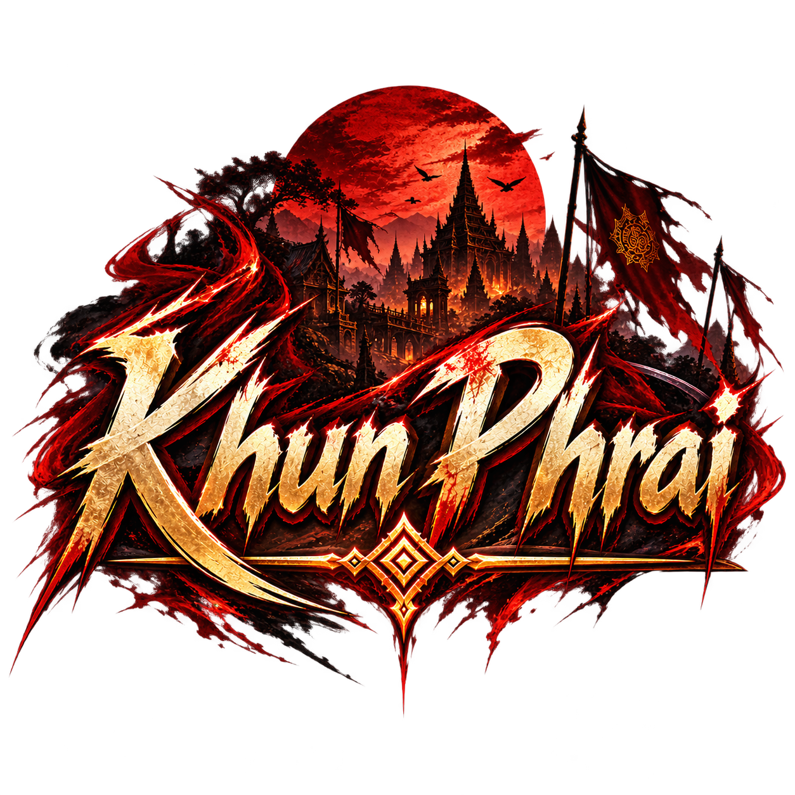

[🎮 ดาวน์โหลดเกม (Google Drive)](https://drive.google.com/drive/folders/1kAJLzFkfsTwdUesgPTJleMe115SiAFdR?usp=sharing) · [▶ ชม Gameplay (YouTube)](https://youtu.be/PA07TFfA_A0) · [📝 แบบประเมินเกม](https://docs.google.com/forms/d/e/1FAIpQLScyswgT1rDhxfuUVcxx-9Fqqdv4ydaaUy7delnOMRzaPxOOgA/viewform)
</div>

---

## 🎮 เกี่ยวกับเกม (Game Overview)

**ขุนพราย (Khun Phrai)** เป็นเกม 3D มุมมองบุคคลที่สาม ผู้เล่นรับบทเป็น **อินทร์** ชาวบ้านธรรมดาที่ต้องออกตามหาครอบครัวท่ามกลางความไม่สงบในช่วงปลายสมัยอยุธยา ระหว่างทางต้องออกสำรวจ เก็บทรัพยากร ทำภารกิจ และเผชิญหน้ากับศัตรู

- **Engine:** Unity 3D
- **Programming Language:** C#
- **Genre:** Action / Souls-like / Survival
- **Perspective:** Third-Person
- **Repository:** รวบรวม C# Source Code เพื่อแสดงผลงานด้าน Game Development ไม่ใช่ Unity Project ฉบับเปิดเล่นได้ทันที

## 🎮 ดาวน์โหลดเกมและร่วมประเมิน (Play & Feedback)

สามารถดาวน์โหลดเกมเวอร์ชันเล่นได้จาก Google Drive และรับชมวิดีโอแสดง Gameplay ได้จากลิงก์ด้านล่าง

- **[⬇️ Download Game — Google Drive](https://drive.google.com/drive/folders/1kAJLzFkfsTwdUesgPTJleMe115SiAFdR?usp=sharing)** — ไฟล์เกมสำหรับทดลองเล่น
- **[▶️ Gameplay Video — YouTube](https://youtu.be/PA07TFfA_A0)** — วิดีโอแสดงการเล่นเกม

### 📝 แบบประเมินความพึงพอใจ (Game Evaluation)

หลังจากทดลองเล่น หากสะดวกสามารถร่วมประเมินความพึงพอใจและเสนอความคิดเห็นเพื่อใช้เป็นข้อมูลประกอบการพัฒนาและประเมินผลโปรเจกต์

**[📝 เปิดแบบประเมินเกมขุนพราย — Google Forms](https://docs.google.com/forms/d/e/1FAIpQLScyswgT1rDhxfuUVcxx-9Fqqdv4ydaaUy7delnOMRzaPxOOgA/viewform)**

> หมายเหตุ: ลิงก์ดาวน์โหลดเกมเป็นไฟล์ Build สำหรับเล่น ส่วน Repository นี้รวบรวม Source Code เพื่อแสดงผลงานการพัฒนา

---

## 📸 ภาพตัวอย่างภายในเกม (Gameplay Screenshots)

### 🌳 การสำรวจพื้นที่ (Exploration)
สำรวจพื้นที่และบรรยากาศภายในเกม

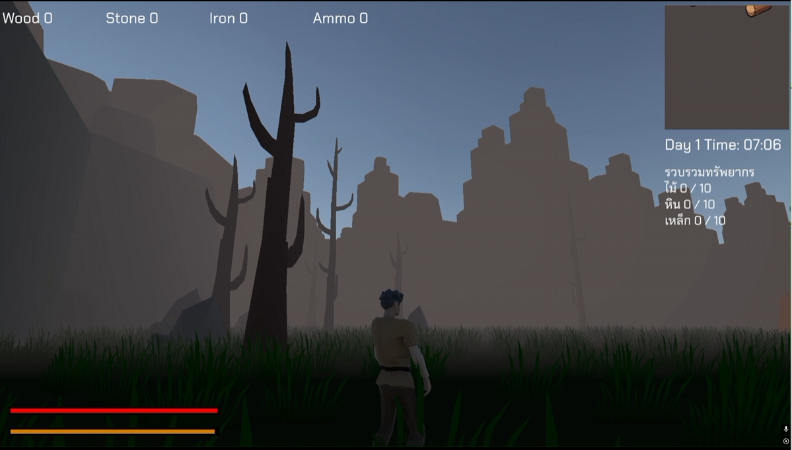

### 📜 NPC & Quest
พูดคุยกับ NPC เพื่อรับภารกิจและดำเนินเรื่องราว

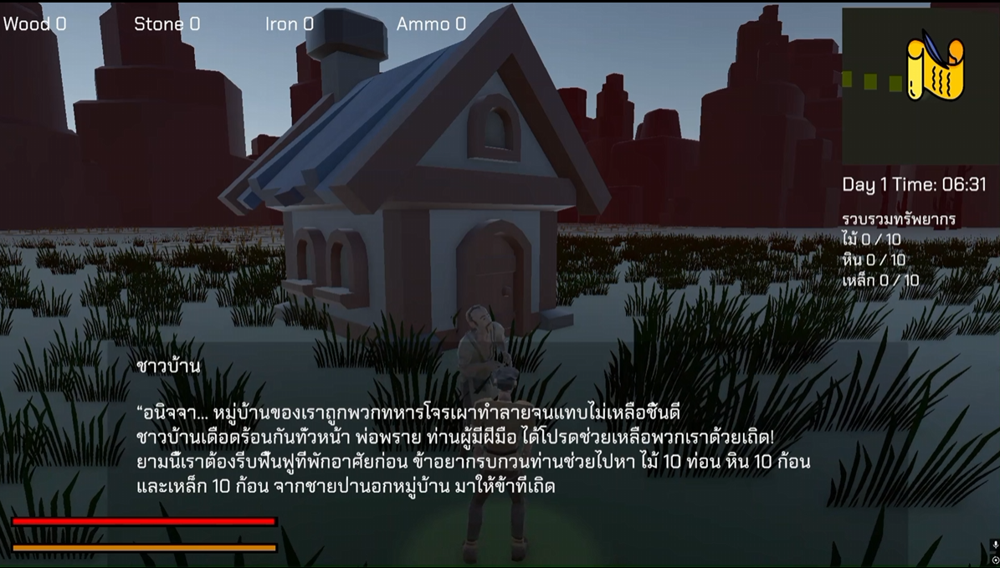

### 🪓 Resource Gathering
รวบรวมทรัพยากรไม้ หิน และเหล็กตามภารกิจ

| เก็บไม้ | ขุดหิน | เก็บเหล็ก |
|:---:|:---:|:---:|
| 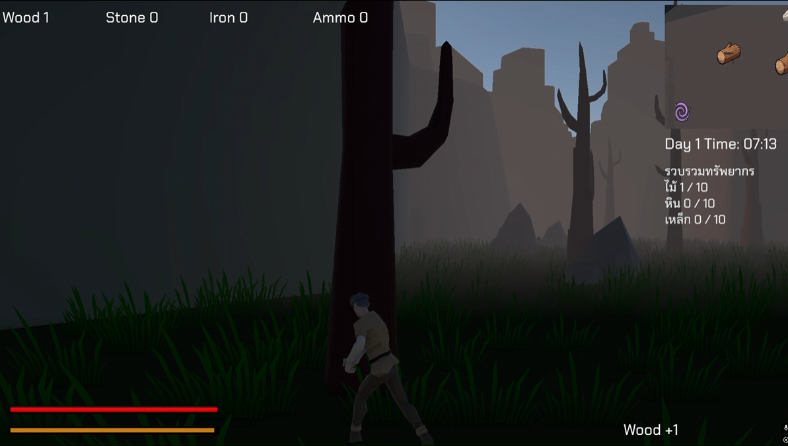 | 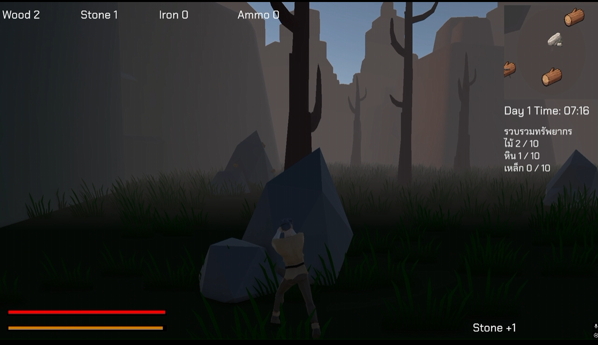 | 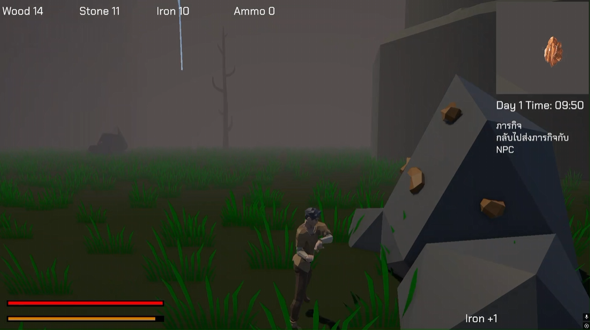 |

### 🏠 House Upgrade
ตัวอย่างบ้านสองช่วงของการพัฒนา

| บ้านก่อนอัปเกรด | บ้านหลังอัปเกรด |
|:---:|:---:|
| 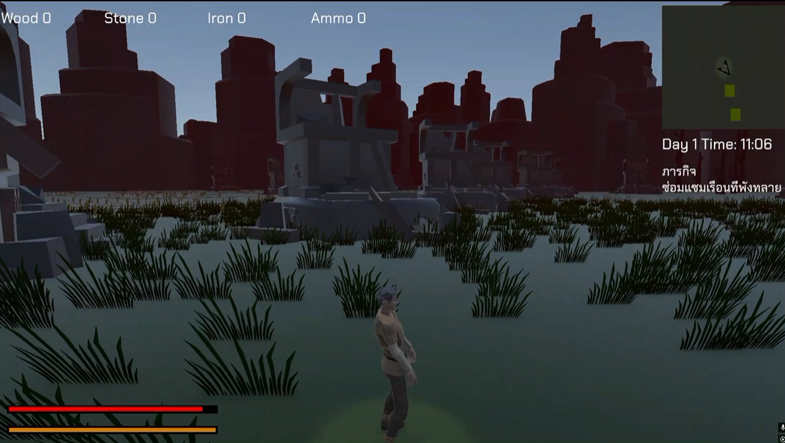 | 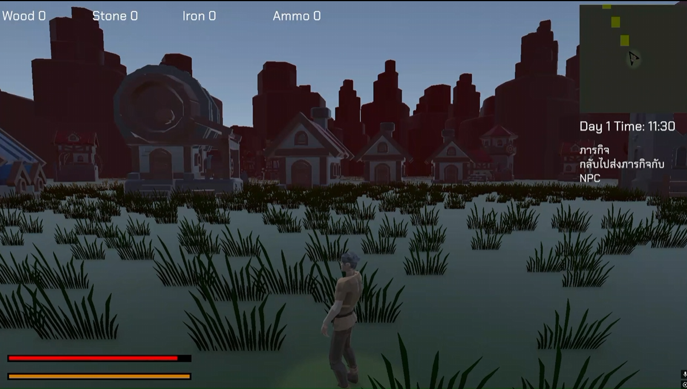 |

### ⚔️ Enemy & Boss Battle
ระบบต่อสู้กับศัตรูทั่วไปและบอส

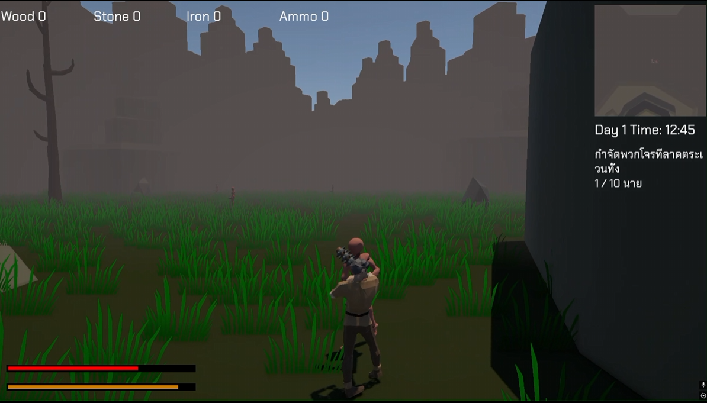
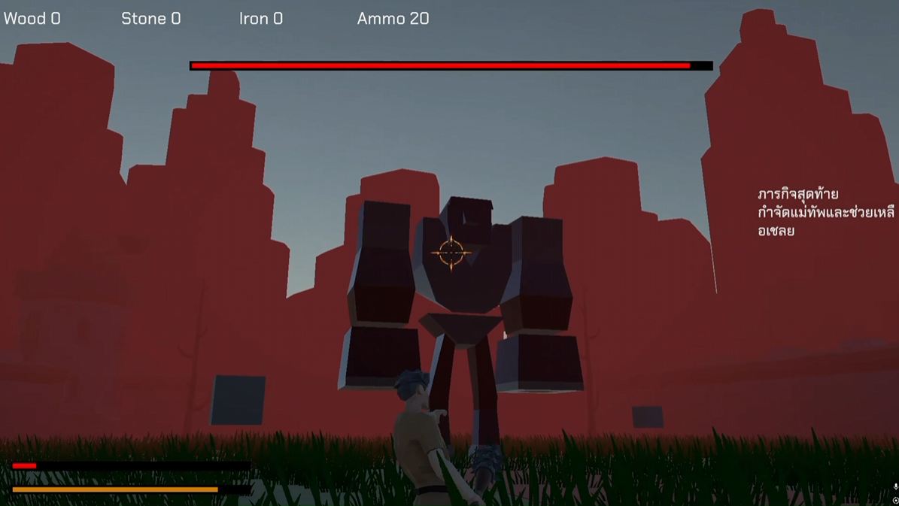

### 🖥️ Main Menu

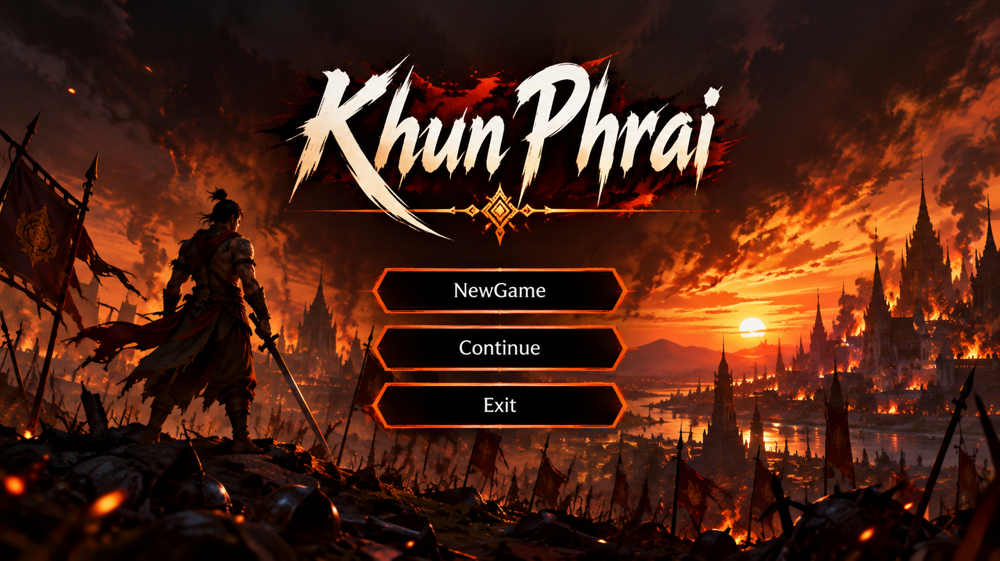

### 🏆 Victory & Defeat

| Victory | Defeat |
|:---:|:---:|
| 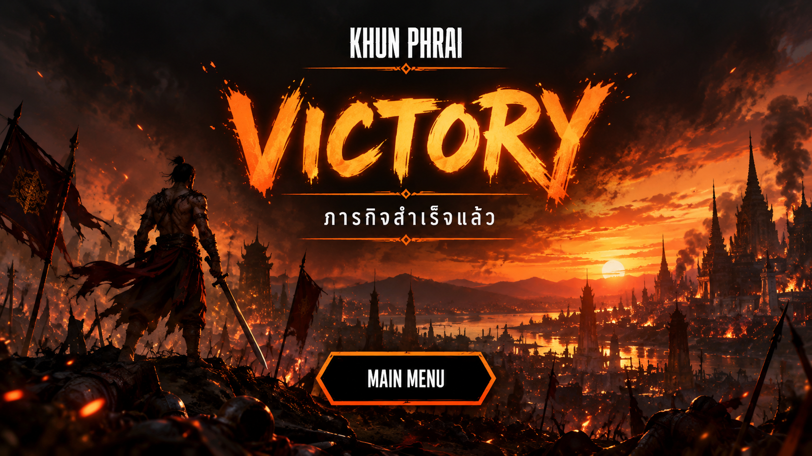 | 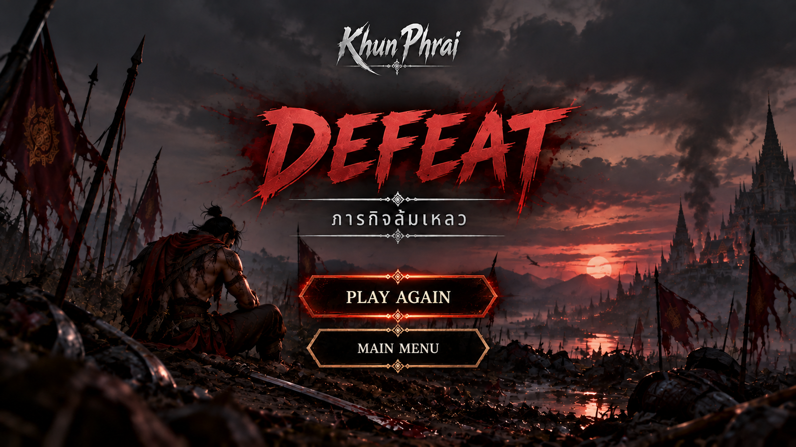 |

---

## 🔄 Game Loop

```text
เริ่มเกม → พูดคุยกับ NPC และรับเควส
                    ↓
          เดินทางไปเก็บทรัพยากร
                    ↓
          กลับมาส่งเควสและรับเควสต่อ
                    ↓
                 อัปเกรดบ้าน
                    ↓
          รับอาวุธและเตรียมตัวต่อสู้
                    ↓
            กำจัดมอนสเตอร์ 10 ตัว
                    ↓
                ต่อสู้กับบอส
                    ↓
                   จบเกม
```

## ✨ ระบบภายในเกม (Game Features)

- **Player Controller:** เคลื่อนที่ เดิน วิ่ง หลบ และเชื่อมต่อ Animator
- **Combat:** โจมตีแบบ Combo, Hit Detection, Hit Stop, การเล็งและโจมตีระยะไกล
- **Enemy AI:** ตรวจจับ เคลื่อนที่ โจมตี และจัดการสถานะศัตรู
- **Boss System:** จัดการการโจมตีหลายรูปแบบและเอฟเฟกต์ที่เกี่ยวข้อง
- **Quest & Dialogue:** บทสนทนา NPC ความคืบหน้าเควส และ UI
- **Survival:** ระบบอาหารและทรัพยากร
- **Day & Night:** วงจรเวลากลางวันและกลางคืน
- **House Upgrade:** ระบบอัปเกรดบ้าน
- **Map & Minimap:** กล้องแผนที่และมินิแมป
- **Save Data:** การบันทึกข้อมูลบางส่วนผ่าน PlayerPrefs

## 👨‍💻 Source Code Highlight

ไฟล์ต่อไปนี้เป็นจุดเริ่มต้นที่แนะนำสำหรับผู้ที่ต้องการตรวจสอบแนวทางการพัฒนาและการแบ่งหน้าที่ของระบบ

| ระบบ | ไฟล์ที่แนะนำ | รายละเอียด |
|---|---|---|
| Player Combat | [PlayerCombat.cs](SourceCode/Player/PlayerCombat.cs) | ระบบโจมตี คอมโบ และตรวจจับการโจมตี |
| Player Movement | [PlayerMoveMent.cs](SourceCode/Player/PlayerMoveMent.cs) | การเคลื่อนที่และการทำงานร่วมกับสถานะผู้เล่น |
| Player Management | [PlayerManager.cs](SourceCode/Player/PlayerManager.cs) | การจัดการข้อมูลและทรัพยากรผู้เล่น |
| Enemy AI | [EnemyMoveMent.cs](SourceCode/Enemy/EnemyMoveMent.cs), [EnemyState.cs](SourceCode/Enemy/EnemyState.cs) | การเคลื่อนที่และสถานะศัตรู |
| Boss AI | [BossAttackManager.cs](SourceCode/Boss/BossAttackManager.cs) | ควบคุมลำดับและรูปแบบการโจมตีของบอส |
| Boss Attacks | [BossStompAttack.cs](SourceCode/Boss/BossStompAttack.cs), [BossRockAttack.cs](SourceCode/Boss/BossRockAttack.cs) | ระบบโจมตีเฉพาะของบอส |
| Quest | [QuestManager.cs](SourceCode/NPC/QuestManager.cs) | จัดการเควสและความคืบหน้า |
| NPC Dialogue | [NPCDialogue.cs](SourceCode/NPC/NPCDialogue.cs) | บทสนทนาและการเชื่อมต่อเควส |
| Survival | [FoodSystem.cs](SourceCode/Player/FoodSystem.cs) | ระบบอาหาร |
| Day/Night | [DayNight.cs](SourceCode/Word/DayNight.cs) | วงจรเวลาในเกม |
| House Upgrade | [HouseUpgrade.cs](SourceCode/Word/HouseUpgrade.cs) | การเปลี่ยนระดับบ้าน |
| Map | [MapCameraController.cs](SourceCode/Map/MapCameraController.cs) | ระบบกล้องแผนที่ |

## 📁 โครงสร้าง Repository

```text
Khun-Phrai/
├── README.md
├── .gitignore
├── Images/           # ภาพ Screenshot และ UI จากเกมจริง
└── SourceCode/
    ├── Audio/
    ├── Boss/
    ├── Box/
    ├── Camera/
    ├── Checks/
    ├── Enemy/
    ├── Map/
    ├── Menu/
    ├── NPC/
    ├── Player/
    ├── Stats/
    ├── Visual/
    └── Word/         # ชื่อโฟลเดอร์จากต้นฉบับ Unity
```

## 🛠️ เครื่องมือและเทคนิค

**Unity 3D · C# · Unity Animator · Animation Events · Unity Physics · Raycast · PlayerPrefs**

## 📈 สิ่งที่ได้เรียนรู้จากโปรเจกต์

โปรเจกต์นี้เปิดโอกาสให้ฝึกออกแบบและเชื่อมต่อระบบเกมหลายส่วน ตั้งแต่ Player Controller, Combat, Enemy AI, Boss AI, Quest System ไปจนถึง UI และการบันทึกข้อมูล รวมถึงการออกแบบ Game Loop ที่พาผู้เล่นผ่านภารกิจต่าง ๆ จนถึงบทสรุปของเกม

## 📺 Gameplay Video

[](https://youtu.be/PA07TFfA_A0)

[▶ รับชม Gameplay ของ Khun Phrai บน YouTube](https://youtu.be/PA07TFfA_A0)

## 👥 ขอบเขตงาน

**Programming / Game Development:** Siwakorn Ponpacharapol

## 📌 หมายเหตุเกี่ยวกับ Repository

Repository นี้เผยแพร่เฉพาะ Source Code และไฟล์ `.meta` ที่เกี่ยวข้อง โดยไม่รวม Scene, 3D Model, Texture, Audio และ Asset ภายนอก จึงไม่สามารถเปิดเป็น Unity Project เพื่อเล่นเกมได้ทันที

โค้ดถูกเก็บตามโครงสร้างที่ได้รับเพื่อให้ผู้ตรวจ Portfolio อ่านและสำรวจระบบได้ง่าย
